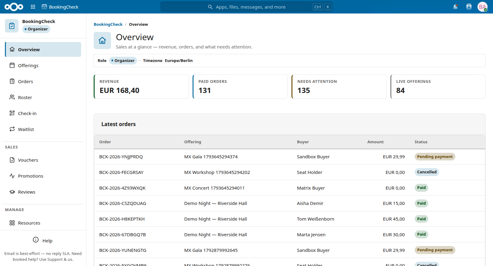
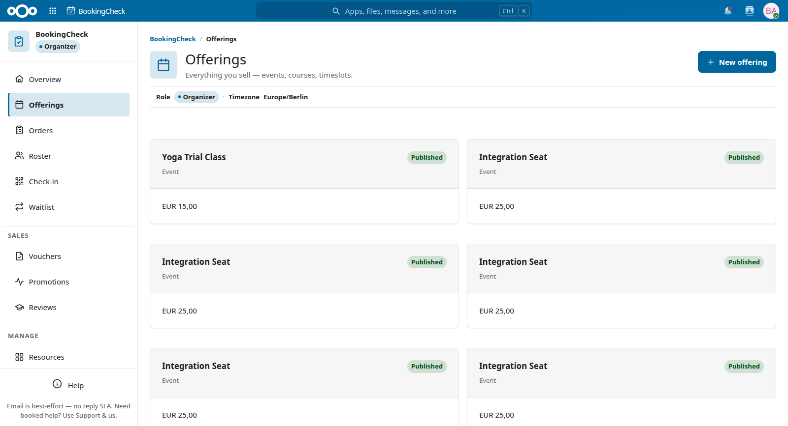
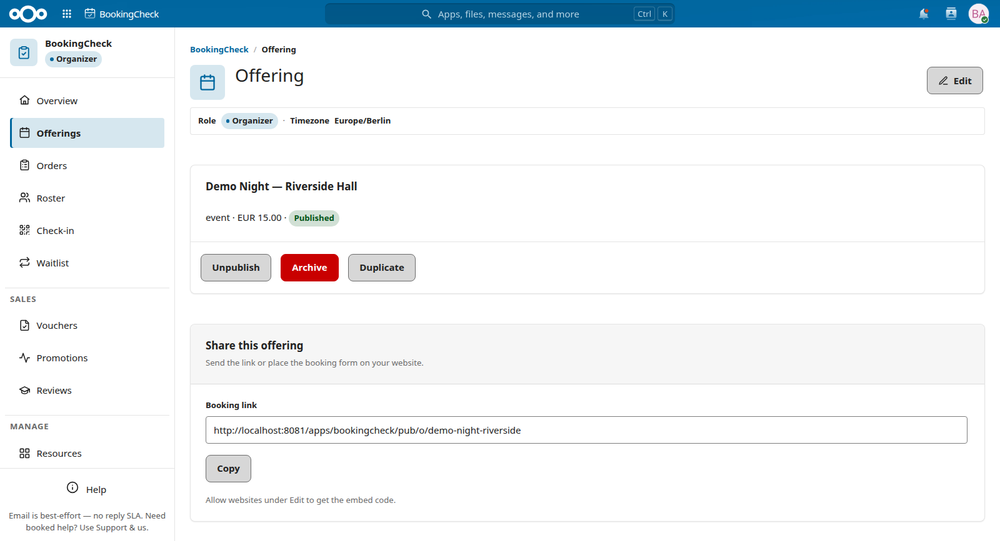
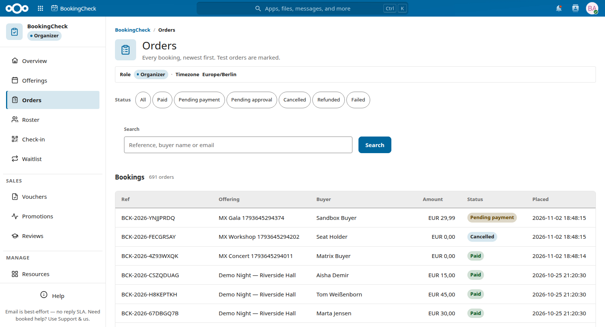
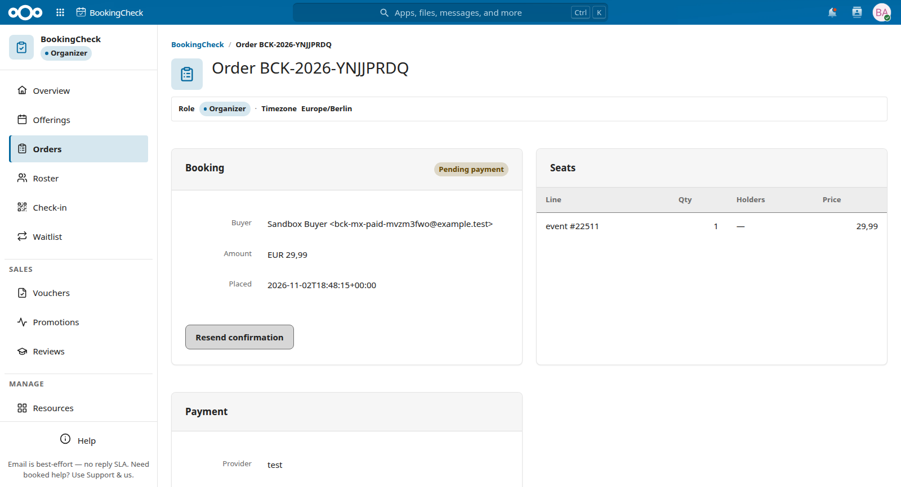
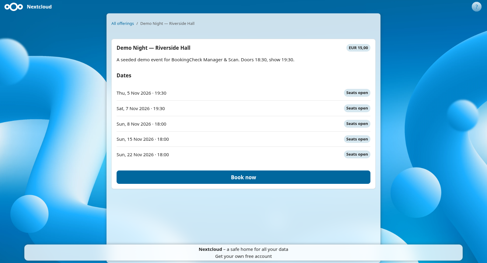

# BookingCheck

[](https://nextcloud.com/)
[](https://www.php.net/)
[](LICENSE)

**[English](#english)** · **[Deutsch](#deutsch)**

Sell seats, courses, timeslots and tickets — guest checkout, real payments, invoicing. Sovereign ticketing without per-ticket commissions.

---

## English

**Your capacity. Your checkout. Your data.**

BookingCheck turns Nextcloud into a bookable-capacity commerce system: one-off events, recurring course series and bookable timeslots with atomic seat reservation, guest checkout (no account needed), Mollie/Stripe payments, gapless invoicing with credit notes, QR tickets, and an email-OTP participant portal.

Your customers' data stays on your server — no per-ticket commission, no third-party attendee database.

**Free web app** (AGPL-3.0-or-later). The official Android companions (Manager & Scan) are licensed add-ons (BCK2 seats).

### Why organizers install it

- **Sell anything seat-shaped** — single events, recurring course series, bookable timeslots; capacity with atomic reservation, never oversold
- **Guest checkout that converts** — buyers book without a Nextcloud account; email-OTP portal to manage their order afterwards
- **Real payments** — Mollie and Stripe with webhook-confirmed state, refunds, vouchers and promo codes
- **Books that close** — gapless invoice numbering with credit notes, e-invoice output and DATEV-compatible export
- **Day-of-event covered** — QR tickets, wallet passes, check-in scan, roster and walk-up sales via the companion apps
- **Demand capture** — waitlist with automatic seat offers, reviews, embed widget for your own website, ICS feeds
- **Suite-native** — outbound webhooks, CRM sync, broadcast mails, config transfer between test and prod

### Clear limits

- BookingCheck sells capacity — it is not a shop for physical goods.
- Payments run through your own Mollie/Stripe accounts; funds never touch Nextcloud.
- Audit entries are append-only.
- Declared databases: MySQL and PostgreSQL.

### Requirements

- Nextcloud 32–35 · PHP 8.2–8.5 · MySQL or PostgreSQL

### Install from Git

```bash
cd /path/to/nextcloud/apps/
git clone https://github.com/aSoftwareByDesignRepository/nextcloud-bookingcheck.git bookingcheck
cd bookingcheck
composer install --no-dev
```

Enable the app in Nextcloud (Apps → BookingCheck) or run `php occ app:enable bookingcheck`.

### Screenshots

| Overview | Offerings | Offering detail |
| --- | --- | --- |
|  |  |  |

| Orders | Order detail | Guest booking page |
| --- | --- | --- |
|  |  |  |

### Security

See [SECURITY.md](SECURITY.md). Do not open public issues that contain production secrets, payment credentials, buyer data, or internal hostnames. Report sensitive findings privately to the maintainer (see `appinfo/info.xml` author).

### Project & support

**Software by Design GbR** · [nextcloud.software-by-design.de](https://nextcloud.software-by-design.de/) · [info@software-by-design.de](mailto:info@software-by-design.de)  
[Support packages](https://nextcloud.software-by-design.de/en/support.html#packages)

### License

[AGPL-3.0-or-later](LICENSE). See [CHANGELOG.md](CHANGELOG.md) for the release history.

---

## Deutsch

**Ihre Kapazität. Ihr Checkout. Ihre Daten.**

BookingCheck macht Nextcloud zum Verkaufssystem für buchbare Kapazität: einmalige Events, wiederkehrende Kursreihen und buchbare Zeitfenster mit atomarer Platzreservierung, Gäste-Checkout (ohne Konto), Mollie-/Stripe-Zahlung, lückenloser Rechnungsstellung mit Storno, QR-Tickets und einem Teilnehmer-Portal per E-Mail-Code.

Kundendaten bleiben auf Ihrem Server — keine Ticketprovision, keine fremde Teilnehmerdatenbank.

**Kostenlose Web-App** (AGPL-3.0-or-later). Die offiziellen Android-Begleiter (Manager & Scan) sind lizenzierte Zusätze (BCK2-Sitzplätze).

### Warum Veranstalter es einsetzen

- **Alles Sitzplatzförmige verkaufen** — Einzelevents, Kursreihen, Zeitfenster; Kapazität mit atomarer Reservierung, nie überverkauft
- **Gäste-Checkout, der konvertiert** — Käufer buchen ohne Nextcloud-Konto; E-Mail-Code-Portal zur eigenen Bestellung
- **Echte Zahlungen** — Mollie und Stripe mit webhook-bestätigtem Status, Erstattungen, Gutscheine und Promo-Codes
- **Bücher, die stimmen** — lückenlose Rechnungsnummern mit Storno, E-Rechnungs-Ausgabe und DATEV-kompatibler Export
- **Veranstaltungstag abgedeckt** — QR-Tickets, Wallet-Pässe, Check-in-Scan, Roster und Walk-up-Verkauf per Begleit-App
- **Nachfrage auffangen** — Warteliste mit automatischem Platzangebot, Bewertungen, Einbettungs-Widget, ICS-Feeds
- **Suite-nativ** — ausgehende Webhooks, CRM-Sync, Broadcast-Mails, Konfig-Transfer zwischen Test und Prod

### Klare Grenzen

- BookingCheck verkauft Kapazität — es ist kein Shop für physische Waren.
- Zahlungen laufen über Ihre eigenen Mollie-/Stripe-Konten; Gelder berühren Nextcloud nie.
- Audit-Einträge sind nur anhängbar.
- Deklarierte Datenbanken: MySQL und PostgreSQL.

### Voraussetzungen

- Nextcloud 32–35 · PHP 8.2–8.5 · MySQL oder PostgreSQL

### Lizenz

[AGPL-3.0-or-later](LICENSE).
